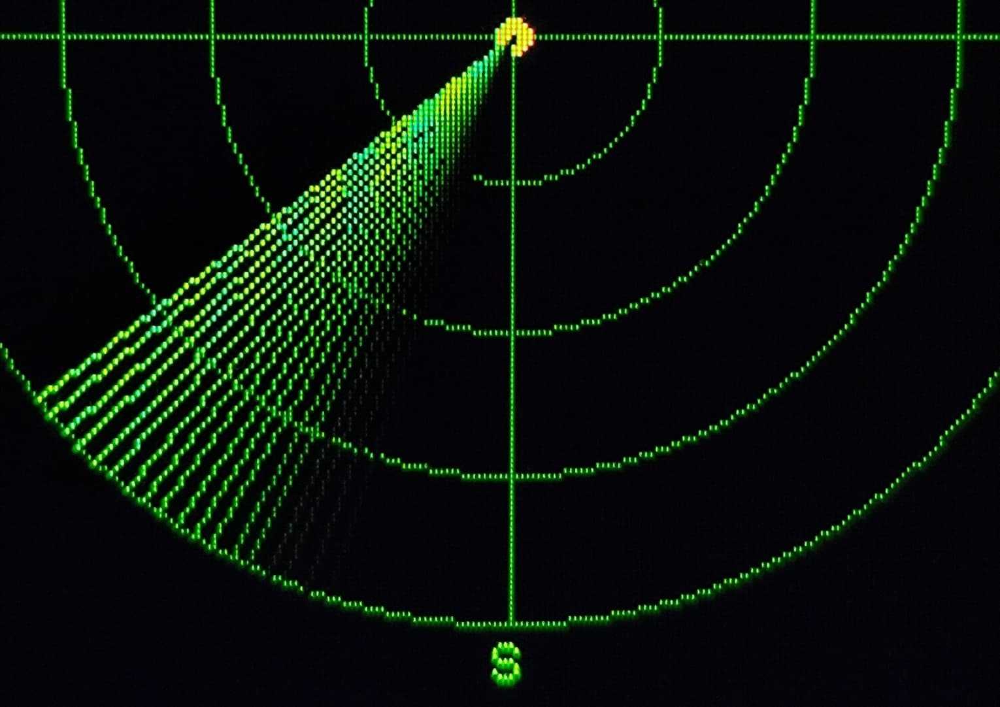
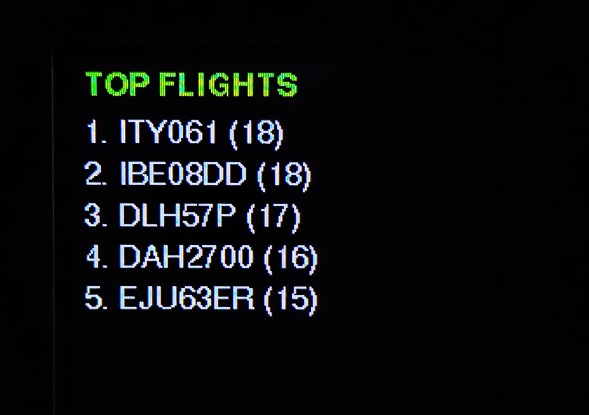
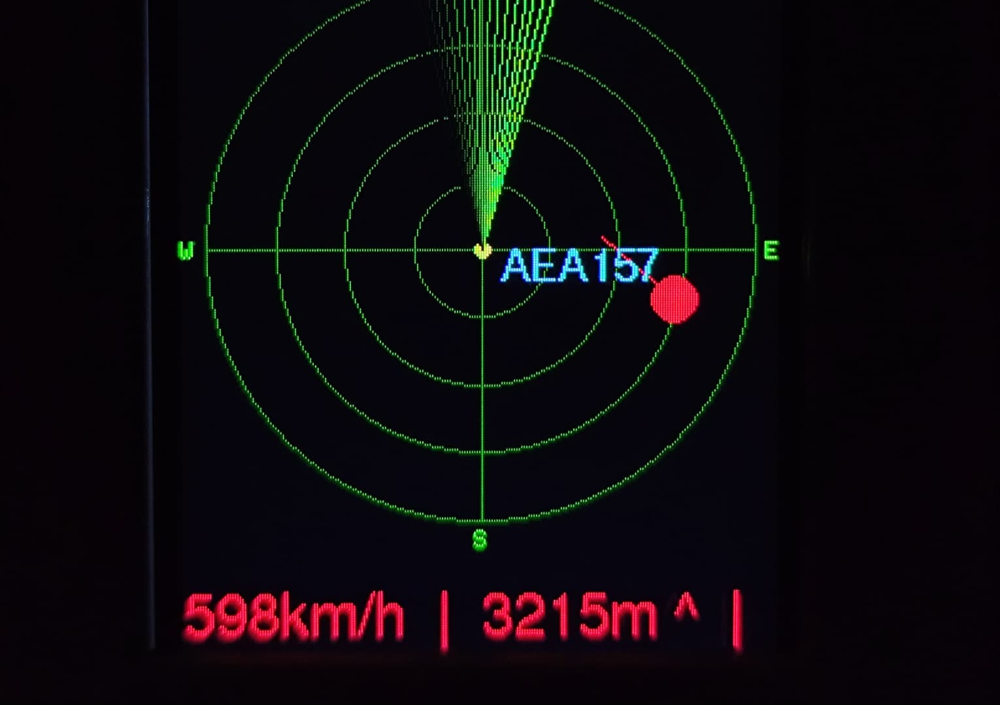
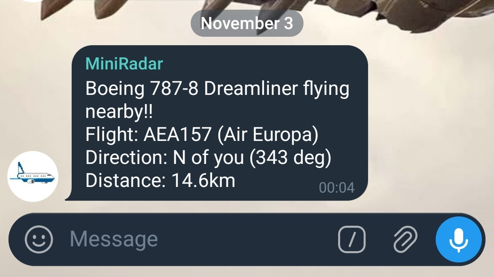

I had an ESP32 board and a 2.4-inch TFT display lying around at home, unused. I like planes, and at some point the idea clicked: why not combine both into a small desk device that shows the aircraft flying around me, like a tiny air traffic radar?

This post explains how it works and the main decisions I made along the way.

## What it does

- **Radar screen:** a rotating sweep line with a fading trail, like a real radar. Every aircraft within 25 km appears as a blip with its callsign and a tail that shows its heading.
- **Scrolling footer:** aircraft type, flight, airline, speed, altitude with a climb/descent arrow, and heading, rotating through the aircraft in range.
- **Special aircraft:** big airliners (747, 777, 787, A350, A380) and several military types (A400M, C-130, C-17, tankers, P-8, AWACS, Chinook) are shown in red, blinking, and the footer locks onto them.
- **Telegram alerts:** if a special aircraft flies within 15 km, I get a message with its type, flight, direction and distance.
- **Three screens, one button:** the radar is the default screen, and the device always starts on it. Each press of the button moves to the next screen: first a detail screen for the nearest aircraft (registration, type, ICAO address, altitudes, speed, heading, squawk, autopilot status), then a ranking of the flights I have seen most often, and then back to the radar.

## Hardware

- ESP32 development board (TODO: exact model).
- 2.4-inch TFT display (TODO: controller, for example ILI9341).
- A push-button module on GPIO 25, powered from GPIO 33 at 3.3 V. The module has its own resistor, so the pin reads HIGH at rest.
- USB power.

## How the data gets in

ADS-B is the signal aircraft broadcast on 1090 MHz with their position, altitude and speed. The ESP32 has no radio for that frequency, so instead of receiving the signals myself, I query the public [airplanes.live](https://airplanes.live/) API over Wi-Fi. It returns every aircraft around a point as JSON:

```cpp
String url = "https://api.airplanes.live/v2/point/"
             + String(MY_LAT, 4) + "/"
             + String(MY_LON, 4) + "/"
             + String(RADIUS_NM, 0);
```

The radius is in nautical miles, so I use 13.5 nm, which is about 25 km. The device polls every 15 seconds, parses the response with ArduinoJson and keeps up to 15 aircraft in a fixed array, which keeps memory use predictable.

## How the code is organised

1. **Setup:** load the sighting history from flash, connect to Wi-Fi, sync the clock over NTP with the Central European time zone, configure the button and initialise the display.
2. **Fetch:** parse the JSON and, for each aircraft, compute the distance and bearing from my position with the great-circle (haversine) formulas.
3. **Drawing:** everything is drawn into an off-screen sprite the size of the screen and pushed to the display in one go.
4. **Loop:** check the button, fetch new data every 15 seconds, and draw whichever screen is active. The three screens are a small state machine.

The key step is turning a distance and a bearing into a position on the screen:

```cpp
float pixelDist = (plane.distance_km / RADIUS_KM) * maxRadius;
float angleRad = radians(plane.bearing_deg - 90);

int x = centerX + pixelDist * cos(angleRad);
int y = centerY + pixelDist * sin(angleRad);
```

The distance is scaled to the radius of the radar on screen. The bearing is rotated by 90 degrees because compass bearings start at north (up), while angle zero on the screen points right.

## Making it look like a radar

The most eye-catching part of the project takes only a few lines. Every frame draws 18 lines: the sweep line itself plus 17 behind it, each 2 degrees after the previous one and a bit darker, which creates the fading trail of a real radar screen:

```cpp
for (int i = 0; i < TRAIL_LENGTH; i++) {
  float trailAngle = angle - (i * SWEEP_SPEED);
  int brightness = map(i, 0, TRAIL_LENGTH, 255, 0);
  drawSweepLine(trailAngle, radarSprite.color565(0, brightness, 0));
}
```

The brightness goes from full to zero in the green channel only, so the trail fades to black. The sweep then advances 2 degrees per frame, which makes a full rotation take a bit more than five seconds, depending on how long each frame takes to draw. Because everything is drawn into the off-screen sprite before being pushed to the display, the animation stays smooth.



## Remembering what it has seen

The ranking screen needs a history that survives reboots. I store it in the ESP32's flash with the `Preferences` library, as a small JSON array of flight code and sighting count.



Two details keep it sensible. A flight only counts as a new sighting if it was not in the previous fetch, otherwise every 15-second poll would add one. And the history is only written to flash when something has changed. When the list is full, the entry with the fewest sightings is replaced.

## Special aircraft take priority

By default the device rotates through all the aircraft in range. But I care more about a rare aircraft than about the tenth Ryanair of the day, so the rare ones interrupt that rotation.

An aircraft is "special" when its description matches a list of types, using simple string matching:

```cpp
bool isSpecialAircraft(Aircraft& plane) {
  String d = plane.desc;
  d.toUpperCase();

  if (d.indexOf("A380") >= 0) return true;
  if (d.indexOf("C-17") >= 0 || d.indexOf("GLOBEMASTER") >= 0) return true;
  // ...more airliners and military types
  return false;
}
```

When one is in range, several things happen at once:

- The radar shows it with a bigger red blip, a longer tail and a blinking effect.
- The scrolling footer stops rotating and stays locked on it, in red.
- A Telegram alert is sent if it is within 15 km.



The common airliners, such as the 737 and the A320, are commented out of the list, since they would trigger it all the time. The matching is deliberately simple and easy to tune. The trade-off is that it depends on how the API words each description, so an unusual variant of a name could slip through.

## Telegram alerts

When a special aircraft is within 15 km, the device sends a message through the Telegram Bot API. To avoid spamming me, it remembers the last ten flights it has already alerted about:

```cpp
if (plane.distance_km <= 15 && isSpecialAircraft(plane) && !wasAlreadyAlerted(plane.flight)) {
  pendingTelegramMsg = plane.desc + " flying nearby!!" ...
  pendingTelegramAlert = true;
}
```

The message is not sent right there. It is stored as pending and sent after the connection to the aircraft API has been closed.



## Problems I ran into

- **Memory:** opening a second secure connection to Telegram while the first one is still open is heavy for the ESP32's RAM. Sending the alert only after closing the API connection fixed it. I also added heap logging to see how much free memory was left.
- **Repeated alerts:** the same aircraft stays in range for several polls, so without the "already alerted" list I would get a message every 15 seconds.
- **Duplicate sightings:** comparing each fetch with the previous one stopped the history from counting the same flight again and again.
- **Button bounce:** a simple 30 ms re-check of the pin removed false double presses.


## Source code

TODO: link to the GitHub repository. Wi-Fi credentials, the Telegram token and my coordinates are kept out of the repo.

## Result

<!--
Add your images here. First copy them to site/src/assets/, then reference them like this:


-->
